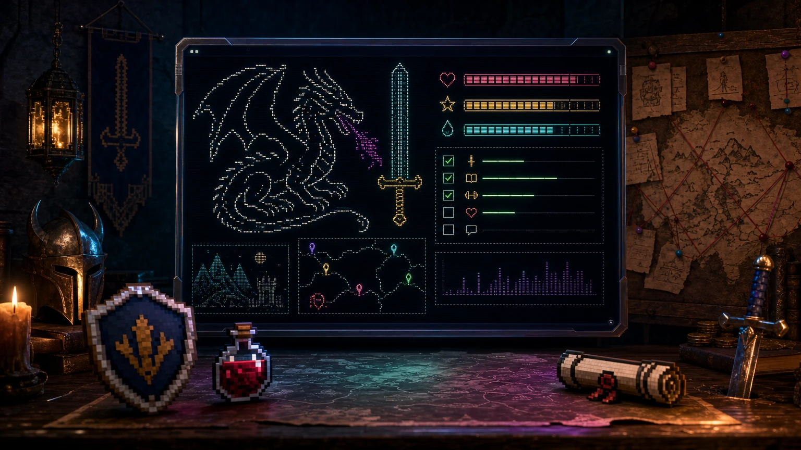

<p align="center">
  
</p>

<h1 align="center">Habitica CLI</h1>

<p align="center">
  <b>Tu centro de mando RPG en PowerShell.</b><br>
  Administra tareas, hábitos, diarias, recompensas, party, chat, quests y retos<br>
  sin salir de la terminal.
</p>

<p align="center">
  
  
  
  
  
  
</p>

<p align="center">
  <a href="#inicio">Inicio rápido</a> ·
  <a href="#caracteristicas">Características</a> ·
  <a href="#comandos">Comandos</a> ·
  <a href="#tui">TUI</a> ·
  <a href="#tests">Tests</a>
</p>

---

<a id="inicio"></a>

## Inicio rápido

```powershell
git clone https://github.com/isDOSe/habitica-powershell.git
cd habitica-cli

Import-Module .\habitica-cli.psd1

h config init     # User ID + API Token
h                 # dashboard
h ui              # panel interactivo
```

Si ya usas un perfil de PowerShell:

```powershell
.\install.ps1 -AddToProfile
```

Consigue tus credenciales en **Habitica → Ajustes → API**.

---

<a id="caracteristicas"></a>

## Características

| | |
|---|---|
| **Dashboard RPG** | HP, XP, MP, oro, nivel, clase, racha y misiones del día en un panel ASCII. |
| **TUI navegable** | Pestañas de Hoy, Tareas, Diarias, Hábitos, Premios, Party, Chat, Quest, Retos, Perfil y Poderes. |
| **Tareas completas** | Crear, editar, completar, deshacer, mover, borrar, buscar y filtrar. |
| **Poderes de clase** | Lista y lanza habilidades con coste de MP, nivel y objetivo desde `h cast` o la TUI. |
| **Checklists** | Ver, agregar, editar, marcar y eliminar items. |
| **Etiquetas** | CRUD, asociar, quitar y reordenar. |
| **Social** | Party, miembros, invitaciones, chat, likes, quests y retos. |
| **API genérica** | Cualquier endpoint de Habitica v3 con `h api`. |
| **Seguridad** | Token cifrado con DPAPI, permisos restringidos y operaciones destructivas confirmadas. |
| **Sin dependencias** | Solo PowerShell y la API oficial. Nada de módulos externos. |
| **Scriptable** | Comandos rápidos para la terminal y cmdlets `Verb-HabiticaNoun` para pipelines. |

---

## Un vistazo

```text
  _   _    _    ____ ___ _____ ___ ____    _
 | | | |  / \  | __ )_ _|_   _|_ _/ ___|  / \
 | |_| | / _ \ |  _ \| |  | |  | | |     / _ \
 |  _  |/ ___ \| |_) | |  | |  | | |___ / ___ \
 |_| |_/_/   \_\____/___| |_| |___\____/_/   \_\

+--[ TU_HEROE  //  PICARO ]--------------------------------------------------+
| NIVEL 42    CLASE Picaro    PUNTOS 3                                       |
| HP  [#############---] 48/50      MP  [######----------] 20/50             |
| XP  [#####-----------] 120/310      ORO 1,245.50 GP                        |
| FUE 24   INT 18   PER 30   CON 21   RACHA 12                               |
+----------------------------------------------------------------------------+

+--[ MISIONES DE HOY  (2 para hoy, 1 vencida) ]------------------------------+
|     # T P   VENCE      INFO     TAREA                                      |
| >   1 T !!  hoy        [1/2]    Comprar leche                              |
|     2 D !!  hoy        x4       Ejercicio                                  |
|     3 T !!! hace 3d    -        Pagar la luz                               |
|                                                                            |
| Completa con: h done <numero>    Detalle: h show <numero>                |
+----------------------------------------------------------------------------+
```

Los índices (`h done 3`) apuntan a la última lista mostrada. También puedes usar un UUID, un alias o un fragmento único del título. Para completar varias de golpe: `h done 1,2,3` (o `h done 1 2 3`).

---

<a id="comandos"></a>

## Comandos

Referencia completa: **[docs/COMMANDS.md](docs/COMMANDS.md)**.

### Tareas

```powershell
h                            # dashboard
h ls                         # todas (diarias activas hoy)
h ls --all                   # todas, incluidas diarias inactivas
h todo                       # pendientes
h dailies                    # diarias activas hoy
h dailies --all              # todas las diarias
h habits                     # hábitos
h rewards                    # recompensas

h add "Comprar leche" --due manana --priority media --tag casa
h add "Ejercicio" --daily --days lun,mie,vie
h add "Beber agua" --habit --up
h add "Ver una película" --reward --cost 20

h show 3
h done 3
h done 1,2,3         # completar varias de golpe
h done 3 --dry-run   # ver cuál se completaría
h which 3            # ver a qué tarea resuelve el 3
h undo 3
h edit 3 --text "Nuevo título"
h move 3 0
h rm 3 --yes
```

### Checklists y etiquetas

```powershell
h check 3
h check add 3 "Revisar anexos"
h tick 3 2
h untick 3 2

h tag
h tag add "Trabajo"
h tag attach 3 "Trabajo"
h tag detach 3 "Trabajo"
```

### Social

```powershell
h party
h party invite <uuid>
h chat "¡A por la quest!"
h chat like 2
h quest
h quest invite <clave>
h challenges --mine
h challenge join 1
```

### Poderes

```powershell
h skills                     # poderes, coste, nivel y estado
h cast 1                     # lanzar el poder #1
h cast 1 --target 3          # sobre la tarea #3 de la última lista
h cast smash 3               # por clave y tarea
h cast herramientas          # poder de equipo
h cast 1 --times 2           # repetir el lanzamiento
```

Los poderes gastan PM y se desbloquean entre los niveles 11 y 14. En la TUI, pulsa `p` o entra en la pestaña **Poderes**.

### Cuenta

```powershell
h stats
h profile
h notify
h inbox
h config
h config test
```

### API genérica

```powershell
h api GET tasks/user
h api GET "user?userFields=stats,profile,party"
h api POST tasks/user '{"text":"Nueva tarea","type":"todo"}'
h api PUT tasks/<id> '{"notes":"Actualizado"}'
```

Cualquier endpoint documentado en <https://habitica.com/apidoc> es accesible.

---

<a id="tui"></a>

## Panel interactivo

```powershell
h ui
```

La TUI usa la **pantalla alternativa** del terminal, se adapta a la altura de la ventana y mide el ancho real de emojis y caracteres CJK. No ensucia el scrollback y al salir recuperas tu pantalla anterior.

| Tecla | Acción |
|---|---|
| `↑` `↓` / `j` `k` | Mover selección |
| `Tab` / `Shift+Tab` | Cambiar pestaña |
| `1`..`9`, `0` | Ir a pestaña |
| `Enter` | Completar / comprar |
| `b` | Comprar recompensa |
| `x` | Deshacer |
| `a` | Agregar tarea |
| `e` | Editar título |
| `d` | Eliminar |
| `c` | Checklist |
| `t` | Etiqueta |
| `m` | Mover al principio |
| `v` | Ver detalle |
| `p` | Ir a Poderes |
| `/` | Filtrar |
| `r` | Recargar |
| `?` | Ayuda |
| `q` / `Esc` | Salir |

En Party: `i` invitar, `l` salir. En Chat: `m` escribir, `l` like, `s` leído. En Quest: `a` aceptar, `s` iniciar, `b` abortar, `i` invitar. En Retos: `j` unirse, `l` salir, `c` crear. En Poderes: `Enter` lanzar, `v` detalle.

Detalle de teclas: **[docs/COMMANDS.md#teclas-de-la-tui](docs/COMMANDS.md#teclas-de-la-tui)**.

---

<a id="instalacion"></a>

## Instalación y configuración

### Requisitos

- Windows 10/11
- Windows PowerShell 5.1 o PowerShell 7+
- Cuenta de Habitica
- Terminal con soporte ANSI

### Importar

```powershell
Import-Module .\habitica-cli.psd1
```

Para cargarlo siempre:

```powershell
notepad $PROFILE
# Añade (ajusta la ruta):
Import-Module 'C:\ruta\a\habitica-powershell\habitica-cli.psd1'
```

O usa:

```powershell
.\install.ps1 -AddToProfile
```

> `h` reemplaza el alias integrado de `Get-History`. `habitica` siempre funciona y `history` sigue disponible.

### Credenciales

```powershell
h config init
```

El asistente guarda la configuración en `%APPDATA%\HabiticaCLI\config.json`, cifra el token con DPAPI y restringe el archivo al usuario actual.

También puedes usar variables de entorno, que tienen prioridad:

```powershell
$env:HABITICA_USER_ID   = 'tu-user-id'
$env:HABITICA_API_TOKEN = 'tu-api-token'
$env:HABITICA_CLIENT_ID = 'tu-user-id-habitica-cli'
```

Comprobación:

```powershell
h config test
```

### Variables opcionales

```powershell
$env:HABITICA_BASE_URL   = 'https://habitica.com/api/v3'
$env:HABITICA_TIMEOUT    = '30'
$env:HABITICA_CLI_HOME   = 'D:\MiConfigHabitica'
$env:HABITICA_CLI_WIDTH  = '100'
$env:HABITICA_CLI_HEIGHT = '30'
$env:NO_COLOR            = '1'
```

---

<a id="tests"></a>

## Pruebas

Las pruebas usan un servidor HTTP local que imita la API. **No tocan tu cuenta real** y usan una carpeta temporal para configuración y estado.

```powershell
powershell -NoProfile -ExecutionPolicy Bypass -File .\tests\Test-HabiticaCli.ps1
powershell -NoProfile -ExecutionPolicy Bypass -File .\tests\Test-HabiticaUi.ps1
```

Resultado esperado:

```text
Pruebas superadas: 154
TUI OK
```

La suite de la TUI simula pulsaciones y comprueba que ningún frame supere la altura del terminal (15, 20, 24 y 30 líneas).

---

## Estructura

```text
habitica-cli/
├── habitica-cli.psd1          Manifiesto
├── habitica-cli.psm1          Carga e inicialización
├── install.ps1                Instalador del perfil
├── src/
│   ├── 00-Common.ps1          Colores, ASCII, ancho visual
│   ├── 10-Config.ps1          Credenciales y DPAPI
│   ├── 20-Api.ps1             Cliente HTTP, errores, reintentos
│   ├── 30-State.ps1           Estado local e índices
│   ├── 40-Tasks.ps1           Tareas y checklists
│   ├── 50-Tags.ps1            Etiquetas
│   ├── 60-User.ps1            Stats, notificaciones, inbox
│   ├── 65-Skills.ps1          Poderes de clase y lanzamiento
│   ├── 70-Groups.ps1          Party, chat, quests
│   ├── 80-Challenges.ps1      Retos
│   ├── 90-Render.ps1          Banner, paneles, tablas
│   ├── 95-Cli.ps1             Parser y ayuda
│   └── 98-Ui.ps1              TUI
├── docs/
│   └── COMMANDS.md            Referencia completa
├── assets/
│   ├── cover.png              Original 1536×864
│   └── cover.webp             Versión optimizada para el README
└── tests/
    ├── Mock-HabiticaServer.ps1
    ├── Test-HabiticaCli.ps1
    └── Test-HabiticaUi.ps1
```

---

## Seguridad

- Token cifrado con **DPAPI**; nunca se imprime completo.
- `config.json` restringido al usuario actual.
- Operaciones destructivas piden confirmación; en scripts requieren `--yes` o `-Force`.
- Solo se conecta a `habitica.com` (o al `HABITICA_BASE_URL` que configures).
- No hay telemetría ni dependencias externas.

Si encuentras un problema de seguridad, abre un issue privado o contacta al maintainer en lugar de publicar el token.

---

## Contribuir

1. Haz fork del repositorio.
2. Crea una rama: `git checkout -b feature/mi-mejora`.
3. Mantén la compatibilidad con **Windows PowerShell 5.1**.
4. Añade o actualiza pruebas.
5. Ejecuta las dos suites.
6. Abre un pull request describiendo el cambio.

Guía de estilo: código y UI en ASCII, mensajes en español, funciones `Verb-HabiticaNoun`, sin dependencias externas.

---

## Licencia

MIT. Consulta [LICENSE](LICENSE).

Habitica es una marca de HabitRPG, Inc. Este proyecto es un cliente no oficial y no está afiliado a Habitica.

<p align="center">
  <sub>Hecho con PowerShell, ASCII y una cantidad cuestionable de cafeína.</sub>
</p>
